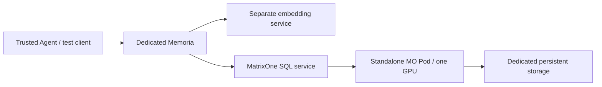

# Design and review boundaries

## Why an experimental schema and isolated deployment

Memoria currently uses string business IDs as primary keys. This MatrixOne CAGRA implementation requires a signed BIGINT table key. The experiment therefore changes the internal key while preserving existing API identity.

Both foreground index operations and asynchronous maintenance need a GPU-capable runtime. Directing client SQL to a GPU CN alone does not establish where background work runs in a mixed CPU/GPU cluster. The tested topology uses one standalone GPU MatrixOne Pod with its own CN, TN/DN, and LogService/HAKeeper.



The embedding model converts text into fixed-dimension vectors. CAGRA indexes/searches those vectors. This branch does not implement an embedding model in MatrixOne or change the embedding algorithm.

## Internal key and public identity

Experimental user/group main memory tables use:

```sql
id BIGINT AUTO_INCREMENT PRIMARY KEY,
memory_id VARCHAR(64) NOT NULL UNIQUE
```

APIs, receipts, references, and external callers still use string `memory_id`. Numeric IDs stay internal.

The storage layer checks actual column metadata before compatibility migration and before the schema-version fast path. It rejects incompatible string-key tables, unsigned/non-auto-increment keys, and missing business-ID uniqueness. Enabling the flag does not convert an existing table.

Runtime validation happens before automatic topology detection/legacy migration. It requires explicit multi-db configuration and rejects graph retrieval enabled with the experiment. A fresh isolated registry remains an operator requirement: checking configuration is not proof that a database is otherwise empty.

## Policy propagation and index ownership

`DbRouter` passes the experiment policy to user/group stores, including schema initialization stores. Background store clones retain the policy and database qualification.

Experimental services do not start the IVF monitor/worker. Storage-level rebuild and rebuild-condition methods also return before executing SQL, covering governance/plugin/direct callers.

CAGRA indexes are explicitly created in each user's database, and MatrixOne owns their asynchronous maintenance. Memoria does not set MO experiment variables automatically, create indexes for new users, select capacity, or supply a CAGRA rebuild policy.

The provided index uses capacity 128, two build threads, and small graph parameters. These are smoke-test settings, not production sizing guidance.

## Graph retrieval and default behavior

Graph retrieval is disabled before constructing the graph query pool in experimental mode. The vector/fulltext hybrid path and existing user/session/subject/type filters remain in use. Ranking weights and vector distances are unchanged.

`MEMORIA_GRAPH_RETRIEVAL_ENABLED` defaults to true outside the experiment and false inside it. Experimental mode cannot re-enable graph retrieval through the runtime constructor or lightweight service policy setter. `ENTITY_POOL_SIZE=0` separately disables asynchronous entity extraction for this deployment. Graph tables and all graph writes are not removed by this change.

CAGRA's internal nearest-neighbor graph is distinct from Memoria's entity/relationship graph retrieval. Disabling the latter does not disable the former.

## Code map

Paths below are relative to `memoria/crates/`:

| File | Responsibility |
| --- | --- |
| `memoria-service/src/config.rs` | Flags, defaults, early validation |
| `memoria-cli/src/main.rs` | HTTP serve and local MCP startup wiring |
| `memoria-storage/src/cuvs_experiment.rs` | Signed internal-key / unique business-ID checks |
| `memoria-storage/src/store.rs` | DDL, pre-migration checks, background policy, IVF guards |
| `memoria-storage/src/router.rs` | User/group policy propagation |
| `memoria-service/src/service.rs` | Graph-pool/traversal and IVF-monitor exclusion |
| `memoria-service/tests/cuvs_local_it.rs` | Disposable local CPU database coverage |

## Acceptance scope

- The initial scope is ordinary memory operations on the default main table. Branch/snapshot restore/merge, historical table cloning, and related advanced operations need separate validation with the extra internal key.
- Correct API results may come from scanning or fulltext fallback. `vector_hit` does not identify the index algorithm; inspect SQL plans independently.
- Index freshness is asynchronous. Single-run visibility observations are not immediate read-after-write guarantees.
- This isolated topology does not modify the scheduling policy of a shared mixed CPU/GPU MatrixOne cluster.
